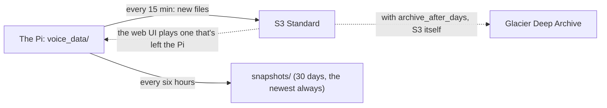

# Backing up to S3

SD cards die, and what TARS keeps is the household's own: the labels and recordings it learns from, the voiceprints,
the wake models trained on the household's voices, months of conversations. With `[backup]` on, TARS copies all of it
to an Amazon S3 bucket a few minutes after it's made, and keeps the Pi's card from filling with recordings: after a
month, most recordings live only in the bucket.

## What it does

`voice-assistant --backup` (`backup.py`) runs one pass, every 15 minutes from `voice-assistant-backup.timer`:

0. **Checks the bucket is this TARS's.** The first pass marks `<prefix>/owner.json` with the database's own id; every
   pass after checks it, and one from another database (a new Pi's, before the old one's backup is restored onto it)
   writes nothing ([a new Pi](#bringing-things-back)).
1. **Uploads what's new.** Every recording TARS keeps (wake windows, requests, follow-ups) and every file it sent,
   under `<prefix>/audio/...` and `<prefix>/files/...`, encrypted at rest (SSE-S3).
2. **Makes room on the machine.** A recording older than `keep_local_days` (30) is removed from the Pi once the bucket
   is checked to have it whole, and the web UI plays it from the bucket from then on. What something reads from the
   Pi later stays there as well: wake windows training learns from, the newest 25 requests of each voice (a
   voiceprint is rebuilt from them when voices are regrouped, and a voice named months later still has them), and the
   files TARS sent (the web UI hands them out). A wake labeled in Review after its audio left comes back on the next
   pass.
3. **Deletes what TARS no longer keeps.** A conversation or wake deleted in the web UI, or old audio dropped by
   `[learning] keep_audio_days`, is deleted from the bucket too: the bucket holds what TARS keeps, no more. A pass that
   would delete more than half of the bucket, and more than 20 files, stops instead and says so: that's far likelier a
   database gone wrong than a household deleting its whole history. If it really is that, `voice-assistant --backup
   --delete-anyway` does it.
4. **Takes a snapshot, every six hours.** The database (through SQLite's backup API, so the copy is consistent while TARS
   writes), the voiceprints, the wake models trained on the household (the self-learning pairs and
   `models/personal/`) and `config.local.toml`, as one `.tar.gz` under `<prefix>/snapshots/`. Never `.env`: the keys
   stay on the Pi. Snapshots older than `keep_snapshots_days` (30) are deleted then, but never the newest: a Pi that
   was off for longer still has one to restore.
5. **Keeps the bucket's lifecycle rule in step** with `[backup]`: with `archive_after_days` set (it's 0, off, by
   default), the audio moves to Glacier Deep Archive that many days after it's made ([what it costs](#what-it-costs)).
   Only TARS's own rule is touched; any other rule on the bucket stays.

What's in the bucket is recorded in the database (`remote_files`), so a pass only looks at what's new. How the last
pass went is in `voice_data/events/backup.json`, and `--check` reads it.



## Setting it up

1. **A bucket.** In the AWS console, S3, Create bucket: a name, the region nearest the house (`eu-central-1`, say),
   and leave Block all public access on (the default). Server-side encryption with S3-managed keys is on by default.
2. **A user that may use only that bucket.** IAM, Users, Create user (`tars-backup`), no console access; then add an
   inline policy with this JSON, with your bucket's name, and create an access key for it ("Application running
   outside AWS"):

   ```json
   {
     "Version": "2012-10-17",
     "Statement": [
       {
         "Effect": "Allow",
         "Action": ["s3:ListBucket", "s3:GetLifecycleConfiguration", "s3:PutLifecycleConfiguration"],
         "Resource": "arn:aws:s3:::tars-home"
       },
       {
         "Effect": "Allow",
         "Action": ["s3:PutObject", "s3:GetObject", "s3:DeleteObject", "s3:RestoreObject"],
         "Resource": "arn:aws:s3:::tars-home/tars/*"
       }
     ]
   }
   ```

   Without the lifecycle permissions the backup still works; `--check` warns, and the rule is set by hand (S3, the
   bucket, Management, Lifecycle rules: `tars/audio/` to Glacier Deep Archive), if you've set `archive_after_days`.
3. **The key and the settings.** In `.env`: `AWS_ACCESS_KEY_ID` and `AWS_SECRET_ACCESS_KEY`. TARS reads them from
   there only, never from the shell or `~/.aws`. In `config.local.toml`:

   ```toml
   [backup]
   enabled = true
   bucket = "tars-home"
   region = "eu-central-1"
   ```

4. **Start it.** On a Mac, `uv sync --extra backup` first (on the Pi, `install-pi.sh` installs every extra).
   `uv run voice-assistant --backup` runs a pass now; the first uploads everything kept so far, which can take a
   while. `deploy/install-pi.sh` installs and starts the timer. `uv run voice-assistant --check` then has a Backup
   line: the bucket answers, how many files are there, and when the last good pass was.

## Bringing things back

- **A recording the web UI plays** comes from the bucket by itself, until it's archived.
- **Training on another machine** reads the labeled wake windows from the Pi, which keeps them. For anything else,
  `uv run voice-assistant --fetch-audio` brings back every file the bucket has and the Pi doesn't, to stay for
  another `keep_local_days`. Archived audio needs `--fetch-audio --restore-archived`: S3 restores it within 48 hours
  (the bulk tier, the cheapest), and running `--fetch-audio` again then brings it back.
- **A new Pi.** Install TARS (`deploy/install-pi.sh`), put the key in `.env` and `[backup]` in `config.local.toml`,
  stop TARS (`systemctl --user stop voice-assistant voice-assistant-web voice-assistant-telegram
  voice-assistant-backup.timer`), then `uv run voice-assistant --restore-backup`. It puts the latest snapshot in place
  (the database, voiceprints, wake models and `config.local.toml`), each where this Pi's config puts it, and refuses
  while TARS or a backup pass is running, or over a database with a history of its own: if TARS heard anything before
  the restore, move `voice_data/events/events.db` away first. Start TARS again. The first backup pass (within 15 minutes, or
  `uv run voice-assistant --backup` now) brings back what has to be on the Pi: the wake windows training learns
  from, each voice's newest requests, and the files TARS sent. The other recordings play from the bucket, and
  `--fetch-audio` brings them back onto the Pi too. A restore puts back the database as it was at the last snapshot,
  so up to six hours of conversations can be missing; their recordings stay in the bucket, unused. Until the restore, the new Pi's backup writes nothing to the
  bucket, and `--check` says why. To start a new backup from scratch instead, set `[backup] prefix` to a new folder.

## What it costs

At about 60 wakes and requests a day, TARS keeps about 12 MB of audio a day, 4-5 GB a year. As a rough guide (check
[S3's prices](https://aws.amazon.com/s3/pricing/) for your region): a year of it in S3 Standard is about $0.10 a
month, and a pass every 15 minutes a few cents a month in requests. Deep Archive would store a year's audio for a
cent or two a month, but moving each recording there costs about $1 a year in all, about what it saves for the first
few years, and an archived recording takes up to 48 hours to bring back and can't be played in the web UI. That's
why `archive_after_days` is 0 (off) by default. With it on, Deep Archive keeps an object for at least 180 days:
deleting one sooner (a conversation deleted in the web UI) is charged as if it had stayed.

## What it sends AWS

AWS gets everything TARS keeps: the recordings, the files it sent, and in the snapshots the database, with its
transcripts and voice embeddings, the voiceprints and the wake models. It's encrypted at rest, in a bucket only the
backup's key may read. Nothing else goes there, and `.env` never does.

## Design

**A process of its own, on a timer.** Like the web UI and Telegram, the backup (`backup.py`) runs beside the
assistant, never in it: a slow upload or a failing network never touches the voice. A pass is a systemd oneshot at
the lowest CPU and I/O priority. A pass and a fetch hold a lock in the event log's folder, so two never run at once:
one started meanwhile is skipped.

**The bucket mirrors what TARS keeps.** Deleting a conversation in the web UI deletes its audio from the bucket on the
next pass, as from the Pi. A backup that kept everything forever would undo the household's own deletes.

**One bucket, one database.** A database makes itself an id the first time a backup asks, and the snapshots carry
it, so a database restored from one is still the same. The bucket's `owner.json` names the database whose backup it
is, and a pass from any other stops before writing anything. Without it, a new Pi set up before the restore would
upload its own recordings into the old Pi's backup, and its snapshot would become the latest: the one a restore
would bring back.

**What's read from the Pi stays on the Pi.** Training copies the labeled wake windows from the Pi over SSH
([training](../training/README.md)), regrouping voices rebuilds each voiceprint from its requests on the Pi, and Deep
Archive takes up to 48 hours to bring anything back. So those stay, and only recordings nothing reads from the Pi
later leave it. Which files TARS keeps, and which must stay, the event log and the conversations say themselves
(`EventLog.kept_files`, `ConversationLog.kept_files`): a new kind of file is backed up the day it's added there.

**Nothing is removed until the bucket has it whole.** Before a file leaves the Pi, the bucket's copy is checked to be
there and the same size; one that isn't is uploaded again. A file fetched back is checked against the size it was
uploaded with.

**S3's lifecycle does the archiving; the pass prunes the snapshots.** Moving an object to Deep Archive is a rule on
the bucket, which S3 applies itself; TARS only keeps its rule in step with `[backup]`. Snapshots aren't left to a rule
because a rule deletes by age alone: a Pi that's off for longer than `keep_snapshots_days` would lose its last one.

**Failures.** Each step of a pass goes on if another fails, and the first failure is kept for `--check`, which warns
after an hour without a good pass. The network down: nothing is removed from the Pi (nothing can be checked in the
bucket), and the next pass catches up. A key that may not set lifecycle rules: a note, and the rest of the backup as
usual. A file gone from the bucket by hand: `--fetch-audio` counts it and goes on, and a pass that needed it back
says it's lost, without failing. A restore copies every file beside where it goes first, then moves them into
place, the database last: one that fails before then changes nothing.
