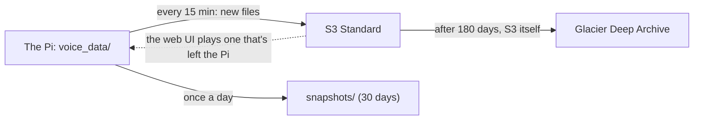

# Backing up to S3

SD cards die, and what TARS keeps is the household's own: the labels and recordings it learns from, the voiceprints,
the wake models trained on the household's voices, months of conversations. With `[backup]` on, TARS copies all of it
to an Amazon S3 bucket, a few minutes after it's made, and keeps the Pi's card from filling with recordings: after a
month, a request's audio lives only in the bucket, and after six months S3 moves it to Glacier Deep Archive, its
cheapest storage.

## What it does

`voice-assistant --backup` runs one pass, every 15 minutes from `voice-assistant-backup.timer`:

1. **Uploads what's new.** Every recording TARS keeps (wake windows, requests, follow-ups) and every file it sent, under
   `<prefix>/audio/...` and `<prefix>/files/...`, encrypted at rest (SSE-S3).
2. **Makes room on the machine.** A request's audio older than `keep_local_days` (30) is removed from the Pi once
   the bucket is checked to have it whole. The web UI still plays it, from the bucket. Two kinds of file stay on the Pi
   as well: a wake window training learns from (training reads them from the Pi), and the files TARS sent (the web UI
   hands them out). A wake labeled in Review after its audio left comes back on the next pass.
3. **Deletes what TARS no longer keeps.** A conversation or wake deleted in the web UI, or old audio dropped by
   `[learning] keep_audio_days`, is deleted from the bucket too: the bucket holds what TARS keeps, no more. A pass that
   would delete more than half of the bucket stops instead and says so: that's far likelier a mistake than a
   household deleting its whole history.
4. **Takes a snapshot, once a day.** The database (through SQLite's backup API, so the copy is consistent while TARS
   writes), the voiceprints, the wake models trained on the household (the self-learning pairs and
   `models/personal/`) and `config.local.toml`, as one `.tar.gz` under `<prefix>/snapshots/`. Never `.env`: the keys
   stay on the Pi.
5. **Keeps the bucket's lifecycle rules in step** with `[backup]`: the audio moves to Deep Archive after
   `archive_after_days` (180), and snapshots are deleted after `keep_snapshots_days` (30). Only TARS's own two rules
   are touched; any other rule on the bucket stays.

What's in the bucket is recorded in the database (`remote_files`), so a pass only looks at what's new. Each step goes
on if another fails; how the last pass went is in `voice_data/events/backup.json`, and `--check` reads it.



## Setting it up

1. **A bucket.** In the AWS console, S3, Create bucket: a name, the region nearest the house (`eu-central-1`, say),
   and leave Block all public access on (the default). Server-side encryption with S3-managed keys is on by default.
2. **A user that may use only that bucket.** IAM, Users, Create user (`tars-backup`), no console access; then add an
   inline policy with this JSON, with your bucket's name, and create an access key for it ("Application running
   outside AWS"):

   ```json
   {
     "Version": "2012-10-17",
     "Statement": [
       {
         "Effect": "Allow",
         "Action": ["s3:ListBucket", "s3:GetLifecycleConfiguration", "s3:PutLifecycleConfiguration"],
         "Resource": "arn:aws:s3:::tars-home"
       },
       {
         "Effect": "Allow",
         "Action": ["s3:PutObject", "s3:GetObject", "s3:DeleteObject", "s3:RestoreObject"],
         "Resource": "arn:aws:s3:::tars-home/tars/*"
       }
     ]
   }
   ```

   Without the lifecycle permissions the backup still works; `--check` warns, and the two rules are set by hand
   (S3, the bucket, Management, Lifecycle rules: `tars/audio/` to Glacier Deep Archive after 180 days, and
   `tars/snapshots/` expired after 30).
3. **The keys and the settings.** In `.env`: `AWS_ACCESS_KEY_ID` and `AWS_SECRET_ACCESS_KEY`. TARS reads them from
   there only, never from the shell or `~/.aws`. In `config.local.toml`:

   ```toml
   [backup]
   enabled = true
   bucket = "tars-home"
   region = "eu-central-1"
   ```

4. **Start it.** `uv run voice-assistant --backup` runs a pass now (the first uploads everything kept so far, which can
   take a while); `deploy/install-pi.sh` installs and starts the timer. `uv run voice-assistant --check` then has a
   Backup line: the bucket answers, how many files are there, when the last good pass was.

## Bringing things back

- **A recording the web UI plays** comes from the bucket by itself, until it's archived.
- **Training on another machine** reads the labeled wake windows from the Pi, which keeps them. For anything that's
  only in the bucket, `uv run voice-assistant --fetch-audio` brings it back onto the Pi. Archived audio needs
  `--fetch-audio --restore-archived`: S3 restores it within 48 hours (the bulk tier, the cheapest), and running
  `--fetch-audio` again then brings it back.
- **A new Pi.** Install TARS, put the keys in `.env` and `[backup]` in `config.local.toml`, then
  `uv run voice-assistant --restore-backup`: it puts the latest snapshot in place (the database, voiceprints, wake
  models and `config.local.toml`), refusing to write over an event log that's there already. The recordings stay in
  the bucket, played from there, until `--fetch-audio` brings them back.

## What it costs

At about 60 wakes and requests a day, TARS keeps about 12 MB of audio a day, 4-5 GB a year. As a rough guide (check
[S3's prices](https://aws.amazon.com/s3/pricing/) for your region): a year of it in S3 Standard is about $0.10 a
month, in Deep Archive a cent or two; moving each recording to Deep Archive costs about $1 a year in all, and a pass
every 15 minutes a few cents a month in requests. Deep Archive keeps an object for at least 180 days: deleting one
sooner (a conversation deleted in the web UI) is charged as if it had stayed.

## What it sends

AWS gets everything TARS keeps: the recordings, the files it sent, and in the snapshots the database, with its
transcripts and voice embeddings, the voiceprints and the wake models. It's encrypted at rest, in a bucket only the
backup's key may read. Nothing else goes there, and `.env` never does.

## Design

**A process of its own, on a timer.** Like the web UI and Telegram, the backup runs beside the assistant, never in it:
a slow upload or a failing network never touches the voice. A pass is a systemd oneshot at the lowest CPU and I/O
priority, and the timer never starts one while another is still running.

**The bucket mirrors what TARS keeps.** Deleting a conversation in the web UI deletes its audio from the bucket on the
next pass, as from the Pi. A backup that kept everything forever would undo the household's own deletes.

**Training data stays on the Pi.** Training copies the labeled wake windows from the Pi over SSH
([training](../training/README.md)), and Deep Archive takes up to 48 hours to bring anything back. So only audio
that nothing reads from the Pi later leaves it: requests, and wake windows training doesn't learn from.

**Nothing is removed until the bucket has it whole.** Before a file leaves the Pi, the bucket's copy is checked to
be there and the same size; one that isn't is uploaded again.

**S3's lifecycle does the archiving.** Moving an object to Deep Archive is a rule on the bucket, which S3 applies
itself; TARS only keeps its two rules in step with `[backup]`.
