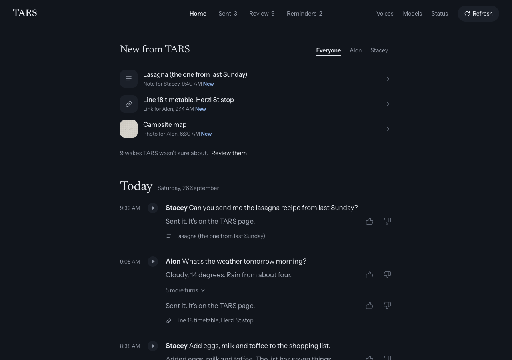
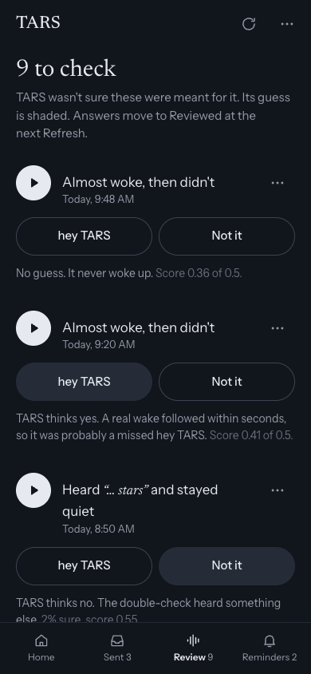
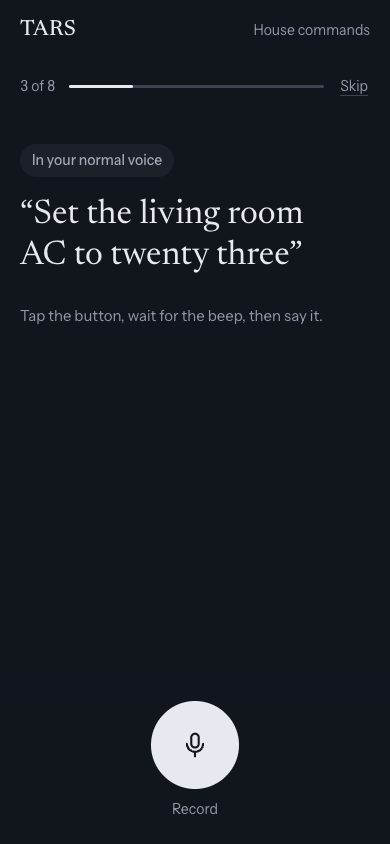
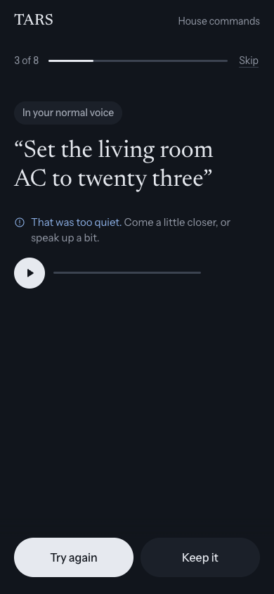

# The web UI

The household's window into TARS: what was said, what TARS sent, the wakes it wasn't sure about, the reminders it's
holding, the voices it has heard, and whether it's all running. It runs on the same machine as the assistant (`voice-assistant --web`) and is
opened from a phone or laptop on the home network. It is a React app over a small FastAPI API, its build is
committed so the Pi needs no Node, and it is covered by unit tests, an end-to-end check against a real backend in CI,
and screenshot tests. The design came from Claude Design (the Day journal direction, in the Linen and ink blue
palette).

## Pages

| Page | What's there |
|---|---|
| **Home** | What TARS sent since the last Refresh, then conversations by day, newest first: who spoke (by voice, or in a [Telegram](telegram.md) chat, marked as one), what they said, what TARS answered and the things it sent, and where an answer failed. Rate an answer with the thumbs, play what was said, name an unknown voice. Tap a conversation to open it: the recordings with a player, Fix text for a misheard transcript, Good and Bad, what TARS sent, how long each answer took and which model wrote it, what TARS heard, and Copy, "Not meant for TARS", Who was talking and Delete. With two or more named people, a filter by person. |
| **Sent** | Everything TARS sent (links, notes, lists, files), New first, filterable by person or Household. The whole house sees the same list, whoever's signed in. Opening, copying or ticking something marks it seen; it stays under New until the next Refresh. |
| **Review** | Wakes no conversation explained (a "Did you call me?" nobody answered, a wake followed by silence, one the double-check turned away), and near-misses a real wake followed within 10 s (probably a missed "hey TARS"; other near-misses stay in the log, out of Review). Play what woke it; answer "hey TARS" or "Not it". TARS's own guess is highlighted, and "Agree with all" answers every one it guessed with its guess, leaving your own answers and the ones it has no guess for. Filter by its guess (Thinks yes, Thinks no, No guess, each with how many) to find the one "hey TARS" among a hundred nos; "Agree with all" then answers only those shown. |
| **Reminders** | Every timer, reminder and message: what TARS will say, for and from whom, how it was set (by voice, on this page or on Telegram), whether it's posted to a Telegram chat rather than said aloud, and where it stands (due, ringing, said 2 of 4 times, acknowledged by whom and how, missed, stopped). Got it or Turn off, Again in 10 min, Stop, and a form to set one, at a time or until someone TARS knows by voice (or by phone, with [who's home](presence.md)) is back. The tab counts what's waiting for a got it. |
| **Skills** | What TARS was taught by talking ([skills](skills.md)): every skill, everyone's and each person's, with what it does, what it's for, and when it runs by itself (a time, or someone coming home, a device changing); what TARS knows each person likes, guesses marked; and what skills did by themselves lately, and why. Pause or resume one that runs by itself, delete a skill, forget a preference. Teaching and changing are by talking to TARS, so there's no form. |
| **Voices** | The voices TARS has grouped: name them (TARS then greets them by name), mark one "not a person", merge two, and Regroup voices. |
| **Models** | The wake model and double-check in use and how they tested, the labeled wakes waiting to be learned from, and the version history, where "Use this" switches back. Training itself runs on a bigger machine. |
| **Status** | Whether each part of TARS is running (the assistant, the web UI, Telegram), since when and which version; the day's wakes, answers and failed answers; each cloud service TARS uses, asked with TARS's own key, beside what the service's own status page says, and Home Assistant when `[home]` uses it; with `[presence]`, how each router last answered and who's home; how the backup's last pass went, and its timer, when `[backup]` is on; and the machine: CPU, load, memory, temperature, the Pi's power and heat warnings, storage and uptime. |

On a phone the pages are tabs along the bottom, Voices, Models and Status sit under the ⋯ at the top, and menus and
dialogs open as sheets from the bottom. The tab title counts what's new: "TARS (3)".

| Home | Review, on a phone |
|---|---|
|  |  |

Every page, on desktop and phone, is in [`screenshots/`](screenshots/) (the demo data, made with
`npm run screenshots`).

## Recording sessions

They record audio, so not with `[learning] log_events = false`, which says not to.

A page of its own, opened from a link TARS sends, that has one person say a list of phrases into TARS's own
speakerphone, one at a time: their voice, so speaker ID knows them from the start, or the house's commands, for
measuring [house commands on the Pi](home.md#house-commands-on-the-pi) on the household's own voices: each thing each
device does, asked the way people ask, from across the room and quietly too, words that name a device without asking
for anything, and plain requests. `voice-assistant --record-session voice|house --for NAME`
makes one and sends its link to NAME's Telegram chat (or prints it). The link is the session's only key, and works for
a day or until the last phrase is done.

Where the recordings go is said on the first page, before anything is recorded, and again at the end. A voice
session's, and a house session's by default, stay on the Pi: none is sent anywhere (the backup doesn't copy them
either). A house session made with `--cloud` (`--record-session house --cloud --for NAME`) says instead that its
recordings are kept on the Pi and that, when they're measured, each one is also sent to Deepgram, a speech to text
service in the cloud, to compare how it hears them; the Telegram message says so too. Only such a session's takes are
ever sent: `tools/commands_bench.py --cloud` leaves every other session's to Vosk on the Pi
([measuring house commands](home.md#house-commands-on-the-pi)).

Each phrase is shown as it should be said, with how to say it ("From across the room", "Quietly"). A tap, a beep from
the speakerphone, and TARS records until you stop talking (or a second tap). Each take is checked straight away, and
one worth doing again says why: nothing heard, too quiet, too loud, cut off or too short. Hear it back, redo it, or
go on; a phrase can be skipped. While the page is open TARS doesn't listen for its name (a phrase can say "hey
TARS"), what's due is still said between takes, and three minutes after the page last asked for anything it listens
again by itself. A session left halfway carries on where it stopped. When a voice session's last phrase is done, its
good takes (at least five) become the person's voiceprint.

| The phrase, before a take | A take that needs doing again |
|---|---|
|  |  |

The assistant does the recording, since it holds the speakerphone: the web UI asks it over a socket in the event
log's folder (`control.py`; [architecture](architecture.md#the-web-ui)), and keeps the takes in the event database
with their audio (`recording.py`).

## Design decisions

### Nothing moves by itself

**Constraint:** a card must never jump out from under your finger. So the page only changes when someone asks it
to. There's no polling and no refresh on focus: the **Refresh** button (and reloading the page) is the only thing
that brings in new conversations and wakes, and the only thing that moves finished items: seen things leave Home's
strip and Sent's "New", answered wakes move from "To check" to "Reviewed". Your own taps update what they touched and
nothing else.

In code this is one snapshot of ids taken at each Refresh (`store/load.ts`): reloads after an action only update
what the snapshot showed. Changes go to the server one at a time, in the order they were made, and a reload waits
for them, so two quick taps can't arrive out of order and a Refresh never reads what was there before your last
tap. The Status page loads its own data when it's opened, and with Refresh while it's open.

### Guarded by host and origin, and by a passkey

The server only answers to local addresses and names, Tailscale names and `[web] allowed_hosts` (421 otherwise), and
only accepts changes from its own page or a page at a name in `[web] allowed_hosts` (403 otherwise). That closes the
two ways a page elsewhere could reach it through someone's browser ([how](architecture.md#the-web-ui)). With sign-in
off, anyone on the home network can use it; with it on, only someone signed in with a passkey ([signing
in](#signing-in)). Either way Sent is one list for the whole house: a session says who's looking, not what they see.

## Signing in

With `[web] sign_in = true`, every page and API needs a session, made with a passkey: a key pair kept by the phone or
computer (its Face ID, fingerprint or PIN unlocks it), which signs a fresh challenge from TARS to sign in. There's
nothing to type and nothing a look-alike page could reuse: a passkey only answers the name it was made for.

| What | How |
|---|---|
| A first passkey | `voice-assistant --web-invite Stacey`: a one-time link, sent to her Telegram chat if she has one (printed otherwise), good for a day. Opening it and tapping **Make a passkey** makes one and signs her in. |
| Another device | another invite, opened there; a person can have several passkeys |
| Signing in | **Sign in with a passkey** on `/sign-in`, where any page sends someone with no session; the phone offers the passkeys it has for TARS |
| A lost phone | `voice-assistant --web-sign-out Stacey`: signed out everywhere, her passkeys forgotten and her unused invites voided; then a new invite |

The session is a cookie that no script can read (HttpOnly), that no other site's page sends (SameSite=Strict), sent
only over HTTPS when the page is HTTPS (Secure), and good for 30 days. Kept in the database: only a hash of each
session and invite token, and each passkey's public key (`web_sessions`, `web_invites`, `passkeys`).

Without a session, everything answers 401 but the sign-in pages, the page's shell and its built files (which hold no
data), and recording sessions, whose links carry their own token. A page sends someone without one to
`/sign-in?next=<where they were>`, and signing in takes them back there, but only to a page of TARS itself: `next` is
resolved as the browser would, and anything on another site (`https://...`, `//...`, `/\...`, which the browser reads
as `//...`) or not a page at all (`javascript:`) goes to Home instead.

`tests/test_signin.py` walks every route and fails if one answers without a session, so a new one can't forget it. It
also fails on a kind of route it doesn't know how to ask, and on a websocket that lets anyone in: the session check is
HTTP middleware, which websockets don't pass through, so a websocket would need a check of its own (the web UI has
none today). The ceremonies are tested against a software passkey: a wrong origin, a replayed challenge, a passkey
TARS doesn't know, a used or day-old invite are all refused. And `checks/signin.spec.ts` signs in for real, in
Chromium with a virtual authenticator for the passkey ([the checks](#the-checks)).

**HTTPS first.** Browsers make and use passkeys only on HTTPS pages (or `localhost`). On a Pi on Tailscale:

```bash
sudo tailscale cert --cert-file /home/<user>/voice-assistant/tls/cert.pem --key-file /home/<user>/voice-assistant/tls/key.pem <pi-name>.<tailnet>.ts.net
sudo chown -R <user> ~/voice-assistant/tls
```

```toml
[web]
sign_in = true
tls_cert = "tls/cert.pem"
tls_key = "tls/key.pem"
link = "https://<pi-name>.<tailnet>.ts.net:8080"
```

Tailscale's certificates last 90 days: run the same `tailscale cert` again before then. A passkey belongs to the name
the page was opened by: one made at `https://<pi-name>.<tailnet>.ts.net:8080` works there, not at `homepi.local`, so
always use that address (`link` makes TARS's own links use it; with HTTPS, `--web-invite` won't make a link without
it). `--check` says whether sign-in is on, and fails if it's on without HTTPS, or `link` isn't an `https://` name.

### A committed build

`npm run build` writes the page into `src/voice_assistant/webui_static/`, which is committed, so the Pi runs the web
UI with Python alone. The build ends by writing `source.txt` beside it, a hash of everything in `webui/` it was built
from (tests aside), and CI fails if that hash isn't the source's, so the build can't drift from the source. CI then
builds it again, for the end-to-end check. The hash, not the built files, is compared: a registry mirror a patch behind
gives the same page with other minified names.

### The Status page

**Each process says it's running.** The assistant, the web UI and Telegram each rewrite a small file every 30
seconds, `<events folder>/heartbeats/<name>.json`, with when they started and the commit they run (`health.py`). One
whose file is older than three beats has stopped: it crashed, was stopped, or froze whole. It works the same without
systemd (on a Mac), and where there is systemd, the unit's state is shown too when it isn't "active". The heartbeat
is written from a thread of its own, so it never touches the database and nothing the assistant does waits on it;
the flip side is that a process stuck inside its own loop still beats (the assistant's own watchdog exits when the
mic stops, which is how it has hung before).

**Each service is asked, and asked about.** The services are asked with the same checks as `--check`
(`check.service_checks`), each reading something small with TARS's key (a model, the voices, the key's or the bot's own
details; Home Assistant, when `[home]` uses it, is pinged with its token and has no status page; the routers, with
`[presence]`, aren't asked at all: the page shows how they last answered the assistant, which asks them every 30
seconds, so the web UI never signs into them as well ([who's home](presence.md))), and each one's own
status page is read (they all publish Statuspage's `/api/v2/status.json`). Both, because each answers a different
question: the key works, and the service says it's fine. They're all asked at once and given 10 seconds together: one
that hasn't answered by then is shown failing, so a service that hangs can't hold the page up. The answers are kept for
a minute, and while they're being asked, another page gets the last ones. Keys that aren't enough to run TARS at all are
one failing line, "API keys", saying which are missing, in place of the services that need them. **Trade-off:** the
checks spend no tokens, but they are requests on TARS's keys, so the page asks only when it's opened or refreshed, never
in the background.

**The backup says how its last pass went.** As `--check` says it (`check.last_pass`), from what the pass left in
`<events folder>/backup.json`: files in the bucket and only there, and when the last good pass was (flagged after an
hour), or why the last one failed; and whether the timer is running, where there's systemd. The bucket itself isn't
asked, so the page costs no S3 request. A `backup.json` that can't be read is one failing line, not a page that fails.

**What the paid services cost this month.** As `voice-assistant --usage` says it ([usage](usage.md)): the month's
estimated cost so far, against `[usage] monthly_cap_usd` when there's one (flagged from 80%), then by service and model
and by person, with how many calls had no price or were cut off before the provider said what they used, and the date
`prices.toml`'s prices were checked. It's read from the event database when the page asks, and asks no provider.

**The Pi says if it's short of power or too hot.** `vcgencmd get_throttled` reads the firmware's flags (under-voltage,
slowed down, throttled, at the soft temperature limit, each now and since it started) through `/dev/vcio`, so the web
UI's service keeps its devices ([the services](security.md#the-services-on-the-machine)). Without `vcgencmd` it isn't
a Pi, and the row isn't shown. On a Pi where the flags can't be read (the command fails, hangs, or prints something
else), the row is a warning saying why, and the web UI's log says it too: never "Fine", and never left out.

## The API

JSON over HTTP, all under `/api`. Errors carry a readable reason: `{"detail": "..."}`, or for a malformed body
(422) a list of problems with a `msg` each. Requests from an unknown host get 421, and changes from another site
get 403 (see [architecture](architecture.md#the-web-ui)). A change to something switched off (reminders, regrouping
voices, versions of a setup that has none) gets 501, saying what's off. The page loads each list on its own: one that
fails is shown as it last loaded, saying so, and only when none answers is TARS unreachable.

| Method and path | Does |
|---|---|
| `GET /api/status` | Whether voices can be regrouped, how many requests a voiceprint needs, and whether there's a Status page (`health`) |
| `GET /api/health` | What the Status page shows: each process's heartbeat and systemd state, today's counts, the services (asked at most once a minute), the backup (`null` when it's off) and the machine |
| `GET /api/conversations` | The newest 200 conversations, with their turns, sent items and the wake that started each |
| `GET /api/conversations/{id}` | One conversation |
| `DELETE /api/conversations/{id}` | It, its turns, audio and items, and the wake that started it |
| `POST /api/turns/{id}/rating` | `{"rating": "good" \| "bad" \| null}`, TARS's turns only |
| `POST /api/turns/{id}/correction` | `{"text": "..."}` what was really said; the original text clears it |
| `GET /api/audio/turn/{id}` | What someone said, as WAV, from the [backup](backup.md)'s bucket once it's left the machine |
| `GET /api/items` | Everything sent |
| `POST /api/items/{id}/seen` | Marks it seen |
| `POST /api/items/{id}/entries/{n}` | `{"done": true}` ticks a list entry |
| `GET /api/items/{id}/file` | A sent file, always as a download |
| `DELETE /api/items/{id}` | One sent item |
| `GET /api/events` | What Review needs: the newest 500 wakes, and near-misses a real wake followed, waiting for an answer and the newest 500 answered ones, with automatic labels and why (`?limit=n` for the newest n of everything) |
| `POST /api/events/agree` | `{ids}`: each of these nobody has answered takes TARS's guess as its answer, worked out on the server; answered ones and ones without a guess are left. Returns `{answered}` |
| `GET /api/audio/{event}/wake`, `/request` | What woke it, and the request after it, as WAV, from the backup's bucket once it's left the machine |
| `POST /api/events/{id}/label` | `{"label": "real" \| "not_real" \| null}` |
| `POST /api/events/{id}/cluster` | `{"cluster_id": n}` moves a request to a voice and pins it there |
| `DELETE /api/events/{id}` | A wake and its audio (its conversation stays) |
| `GET /api/clusters` | Voices, with sizes and their newest request clips |
| `POST /api/clusters` | `{"name": ..., "kind": ...}` a new voice; without `kind`, a person if it has a name, unknown if not |
| `POST /api/clusters/{id}` | `{"name": ..., "kind": ...}` rename, or mark "not a person"; without `kind`, a "not a person" voice stays one |
| `POST /api/clusters/merge` | `{"keep": a, "absorb": b}` |
| `POST /api/recluster` | Regroup the requests by voice and rebuild the voiceprints |
| `GET /api/models` | The pair in use and its test results, the version history, and the labeled wakes since it was installed |
| `POST /api/models/use` | `{"version": ...}` puts a version in use (`"installed"` is config.toml's) |
| `GET /api/reminders` | Whether reminders are on; up to 200 reminders, active ones first (soonest first), then the rest (newest first), each with what TARS will say; the names TARS knows by voice, and by phone with `[presence]`; and the defaults |
| `POST /api/reminders` | `{"kind", "text", "for_name", "from_name", "due" (Unix time) or "when_back": true, "needs_ack", "repeat_every_min", "max_tries"}`; 400 says what's wrong |
| `POST /api/reminders/{id}/ack` | Acknowledged on the page |
| `POST /api/reminders/{id}/snooze` | `{"minutes": n}` said again then, with all its tries |
| `POST /api/reminders/{id}/cancel` | Stopped before it's acknowledged |
| `GET /api/skills` | Every skill, everyone's preferences, and the last 50 runs by themselves (skills.Skills.page) |
| `POST /api/skills/{id}/pause` | `{"paused": true or false}` |
| `DELETE /api/skills/{id}` | Deleted; 404 if it's gone already |
| `DELETE /api/preferences/{id}` | Forgotten |
| `GET /api/session/{token}` | A [recording session](#recording-sessions): its phrases (not what a command means), takes and skips; 404 once its link is used up or a day old |
| `POST /api/session/{token}/begin`, `/leave` | TARS stops listening for its name for the session, or listens again |
| `POST /api/session/{token}/record` | `{"prompt": id}`: the beep, then a take, answered once it's recording; 409 if TARS is in a conversation or muted, 503 if it isn't running |
| `GET /api/session/{token}/record/{id}` | The take as it goes (seconds, loudness for the meter); kept and checked once it has ended |
| `POST /api/session/{token}/record/{id}/stop` | Ends the take now, and keeps it |
| `POST /api/session/{token}/skip` | `{"prompt": id}` |
| `POST /api/session/{token}/finish` | Once every phrase has a take or was skipped: the link stops working, and a voice session becomes a voiceprint |
| `GET /api/session/{token}/takes/{id}/audio` | A take, as WAV |

## Working on it

```bash
cd webui
npm install
npm run dev        # hot reload on :5173, API proxied to :8080 (or $TARS_API)
npm test           # unit tests (Vitest): markdown, reminders, formatting, Status, Refresh, filters, pending edits
npm run build      # typecheck, then rebuild src/voice_assistant/webui_static/ (committed)
npm run e2e        # the functional checks against a real backend (below)
npm run visual     # the screenshot tests (below); npm run visual:update accepts an intended change
npm run screenshots  # docs/screenshots/, from the current build
npm run site       # the site's pages, site/ into site/dist/ (below)
```

Add `?demo` to the URL for built-in sample data with no server (`?demo=empty` for none, `?demo=long` for
everything long). Real links open a tab, a person, a conversation or an item (`src/params.ts`). With `?demo`, more
parameters open any state (a dialog, a menu, a clip playing; `src/demoParams.ts`), which the checks and screenshots
use.

**Layout:** `src/store/` holds the state (`core.ts`), what views derive from it (`selectors.ts`), loading and the
Refresh snapshot (`load.ts`), tabs and filters (`nav.ts`), menus, dialogs and scrolling (`ui.ts`), and the actions
by area (`items.ts`, `conversations.ts`, `voices.ts`, `models.ts`, `reminders.ts`, with the shared shapes in
`actions.ts`), and the Status page's own load (`health.ts`); `index.ts` exports all but `actions.ts`, which the
action files import directly. `src/components/` has one file per page or part. `src/demo.ts`, `src/demoParams.ts`
and `src/linkStates.ts` are only loaded with `?demo`.

## The checks

All three run headless with Playwright: in the installed Chrome locally; in CI, the end-to-end check and the site
build (`.github/workflows/pages.yml`, `npm run site`) run in Playwright's own Chromium.

- **`npm run e2e`** (`checks/e2e.spec.ts`, a few seconds): builds a throwaway copy of the demo log with
  `tools/webui_demo.py`, serves it, and uses the page like a person would: rate and undo, fix a transcript, tick a
  list, open a note, delete, move a voice, name one with Enter, filter, check that nothing moves until Refresh,
  switch wake models on the Models page, and read the Status page (the demo's services are pretend: no key or
  network is used). Every step is checked against what the server then says. The demo log's
  audio is committed (`tools/demo_audio/`, four synthetic voices made by `tools/make_demo_audio.py`), so it runs on
  any machine. A step that finds the demo missing what it needs fails rather than skipping. Then
  `checks/signin.spec.ts`, against a second backend with sign-in on (`tools/webui_demo.py serve --sign-in`, an
  empty log, at `localhost`, where browsers make passkeys without HTTPS): Chromium's virtual authenticator stands in
  for a phone's passkey to make one from an invite, be sent to sign-in without a session, sign out and back in to the
  page it was on, see a used invite refused, and see `?next=` pointing anywhere but TARS (`/\evil.example`,
  `//evil.example`, another site, `javascript:`) land on Home.
- **`npm run visual`** (`checks/visual.spec.ts`, under 2 minutes): Playwright's `toHaveScreenshot()` on the states
  a link can open and after interactions (opening a menu, rating, ticking, a dialog), on desktop and phone. The page
  loads from the build on disk with a fixed clock, and each screenshot must match its baseline in `checks/screenshots/<platform>/`.
- **`npm run site`** (`checks/site.spec.ts`): builds [the site](https://tars.alonp.dev) from `site/` into
  `site/dist/`: the front page, How it works (one request through TARS) and Features (everything else it does),
  each one file with `site.css`, `site.js`, the fonts and icons inlined, and real pages of the demo (Review, Voices,
  Models, Reminders) cut into Features. It takes the link preview (`og.png`) from the front page, and fails if a
  placeholder it fills is missing or a panel is on no page.

After a change that's meant to look different, run `npm run visual:update`, look at the new images in the diff,
and commit them with the change. `npm test` runs the unit tests (Vitest), `npm run lint` the linter
([oxlint](https://oxc.rs), with React's hooks rules) and `npm run format` Prettier.

**In CI**, on every push: lint, the Prettier check, the unit tests, the committed-build check and the end-to-end
check.

## Limitations

- **The screenshot tests run locally only.** The baselines are per platform because fonts render differently on
  macOS and Linux, and the committed ones are macOS (`darwin`).
- **Sign-in is off by default**, since it needs HTTPS first; until it's on, anyone on the home network can use the
  page ([signing in](#signing-in)). With it on, everyone signed in sees the same house: there are no roles.
- **No live updates**, by design: new conversations and wakes appear on Refresh.
